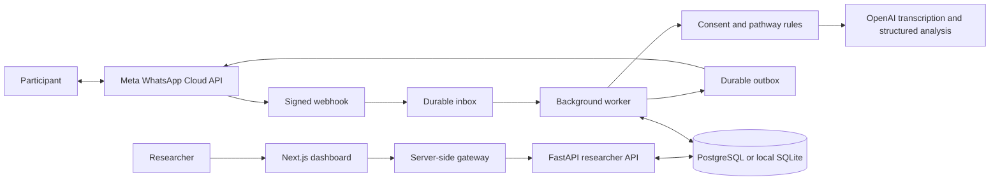

# Echo technical guide

[Read the case study](../portfolio/echo.md) · [See the verification record](VERIFICATION.md)

Echo lets a researcher approve an interview guide, invite a participant through WhatsApp, and review the transcript and follow-up decisions. The public source includes a FastAPI backend, a background worker and a Next.js researcher dashboard. A separately configured internal instance completed the voice interview on Meta’s test number.

## Architecture




The model supplies schema-validated analysis and evidence; application code controls consent, transitions, budgets, persistence, and sending. Downloaded audio is decoded in memory and is not retained as an Echo audio file. Provider handling and external exports have separate retention limits.

**Stack:** Python, FastAPI, Pydantic, SQLAlchemy, PostgreSQL/Supabase, Next.js, TypeScript, React, Meta Cloud API, OpenAI, and FFmpeg-based audio normalization.

## Local quickstart

Requires **Python 3.13+**, **Node.js 22.13+**, and a POSIX shell. Clone this repository and run from its root directory. No Supabase, Meta, or OpenAI account is required to inspect the dashboard, edit the seeded draft, or run the automated tests.

```sh
git clone https://github.com/olamitisoji/AI-Deployment-Projects.git
cd AI-Deployment-Projects
python3 -m venv .venv
.venv/bin/python -m pip install -r backend/requirements.lock
.venv/bin/python scripts/configure_local.py
cd backend
ECHO_ENV_FILE=.env OPENAI_API_KEY= OPENAI_KEY_FILE= ../.venv/bin/python -m echo.manage init-db
ECHO_ENV_FILE=.env OPENAI_API_KEY= OPENAI_KEY_FILE= ../.venv/bin/python -m echo.manage seed-study
ECHO_ENV_FILE=.env OPENAI_API_KEY= OPENAI_KEY_FILE= ../.venv/bin/python -m uvicorn echo.api:app_factory --factory --host 127.0.0.1 --port 8000 --no-access-log
```

In a second terminal, from the Echo project directory:

```sh
cd backend
ECHO_ENV_FILE=.env OPENAI_API_KEY= OPENAI_KEY_FILE= ../.venv/bin/python -m echo.worker
```

In a third terminal, from the Echo project directory:

```sh
cd dashboard
npm ci
npm run dev -- --port 3002
```

Open [the dashboard](http://127.0.0.1:3002) or [the local API explorer](http://127.0.0.1:8000/docs). The setup script generates private local credentials and connects the dashboard gateway without printing the token. It preserves existing settings. The seed creates an **unapproved healthcare-administration research draft**, not participant responses. The worker waits until WhatsApp is configured; invitation creation reports missing Meta configuration. Keep local credential access on loopback.

## Verification

From `backend`:

```sh
../.venv/bin/python -m pytest -q
```

From `dashboard`:

```sh
npm test
npm run typecheck
npm run build
```

The automated checks use provider test doubles. They cover consent, follow-up limits, delivery retries, participant controls, transcript retrieval and withdrawal. The verification record gives the results for the public code snapshot and the later test on a real phone. [Test results](VERIFICATION.md) · [GitHub Actions](https://github.com/olamitisoji/AI-Deployment-Projects/actions/workflows/checks.yml)

## Further reading

- [Interview rules and memory](ENGINE.md)
- [Evaluating interview quality](EVALUATION.md)
- [Configuring a Meta test number](META_SETUP.md)
- [Deployment and secrets](DEPLOYMENT.md)
- [Database setup and permissions](../supabase/README.md)
- [Researcher dashboard setup](../dashboard/README.md)
