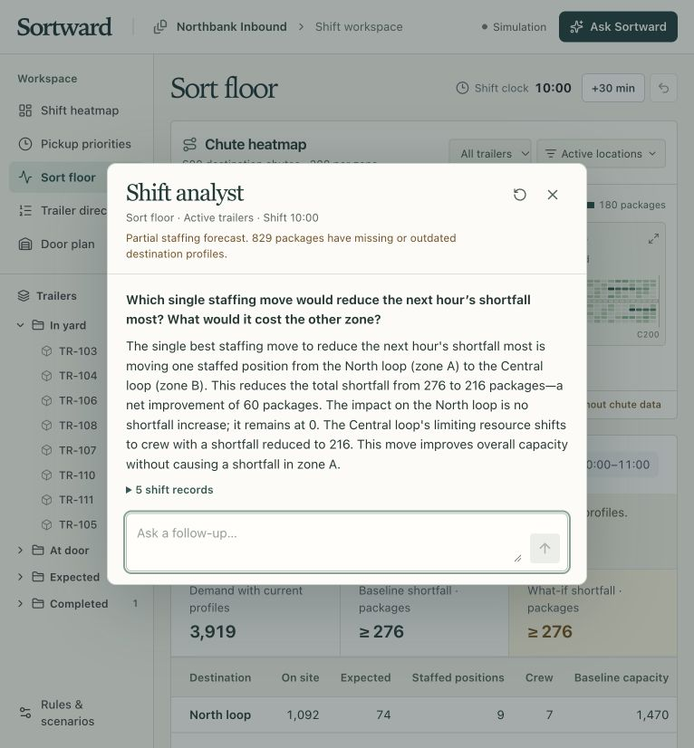
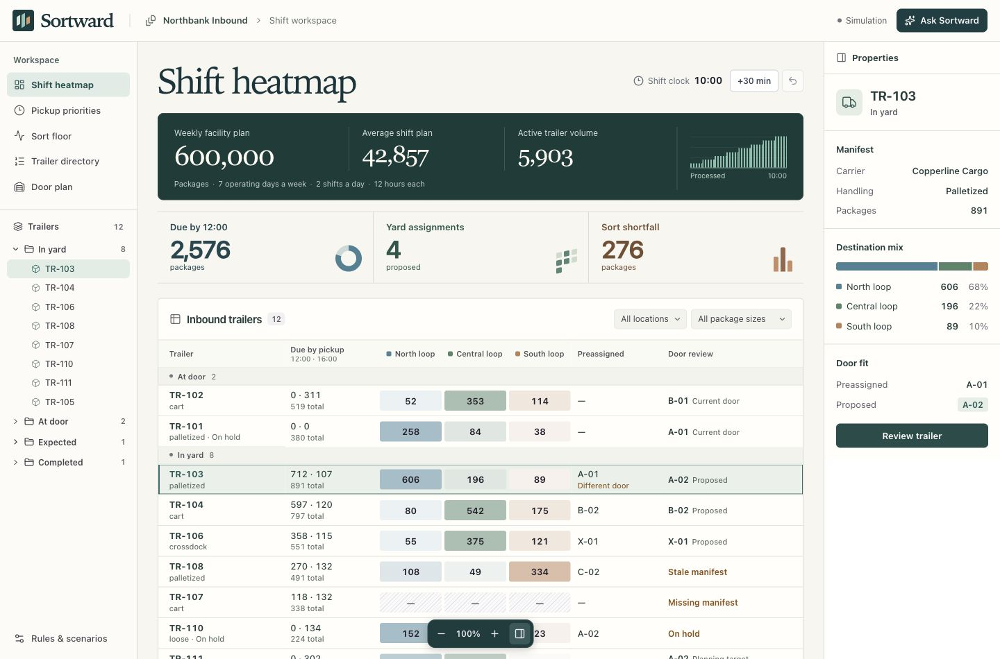

# Sortward

## Inbound shift planning

[Read on my portfolio](https://soji-agboola-portfolio.boileditem.chatgpt.site/work/sortward/) · [Try the public demo](https://dockflow-inbound-lab-olami-1110.boileditem.chatgpt.site/?example=chutes#chute-map) · [View the source](https://github.com/olamitisoji/product-portfolio/tree/main/dockflow) · [View automated checks](https://github.com/olamitisoji/product-portfolio/actions/workflows/dockflow.yml)

**My role** · Product design and AI-assisted implementation of the public simulator

### The operational question

During my Amazon operations internship, I worked on sorter first-pass yield, the share of packages that reach their intended destination on their first pass. A package that misses a chute takes up belt capacity again. The first question at the dock was which freight was due for the next pickup. The next was where that freight would go once we unloaded it.

### What I built on site

I completed a consolidated inbound heatmap that brought trailer status, pickup deadlines and package destinations together. Shift leads could compare what was at the doors with what was in the yard and what was still coming. They could see when an incoming trailer would feed an area already carrying a heavy workload. The door suggestion feature went into pilot.

### What I rebuilt

I used fictional manifests, an original facility layout and independent operating rules to recreate those decisions in Sortward. A shift lead can drill from a pickup window to an individual trailer, see the mix going to each destination, and compare possible doors with the existing door plan and physical occupancy.

The sample facility plans for 600,000 packages a week. The heatmap follows the subset of trailers in the current shift across three zones with 200 chutes each. A shift lead can compare the planned destination of a load with the capacity to handle it before approving a door assignment.

### A decision the analyst can help with

“If I move one staffed position, where would it help most, and what would it cost the zone it came from?” I wanted a shift lead to be able to ask both halves of that question. Sortward calculates the effect of each possible move. The AI uses those comparisons to answer in plain language and cites the records an operator can check.

In the 10:00 sample shift, the analyst suggested moving one staffed position from North to Central. The forecast shortfall for freight with known destinations fell from 276 to 216 packages, and North still had enough capacity for its known load. Another 829 packages had missing or outdated destination profiles. I made that count visible alongside the answer because it could change the staffing decision.

### Walk through a shift

In the sample shift, TR-103 is due for pickup and its planned door, A-01, is occupied. Inspect its load, compare the proposed A-02 assignment, then use Undo to see what changed. The [walkthrough](../dockflow/README.md#try-a-shift) covers pickup windows, chute routing and staffing. The [verification record](../dockflow/docs/VERIFICATION.md#product-review) includes the live analyst’s two-chute comparison.

### How I would evaluate it

I would compare first-pass yield across shifts with a similar freight mix and record why operators accepted or overrode each suggestion. That would help distinguish an improvement in sorting from a shift that happened to receive easier freight.

### Technical documentation

- [Design decisions](../dockflow/docs/DESIGN.md)
- [Verification record](../dockflow/docs/VERIFICATION.md)
- [Setup and learning guide](../dockflow/README.md)

[Back to portfolio](README.md)
